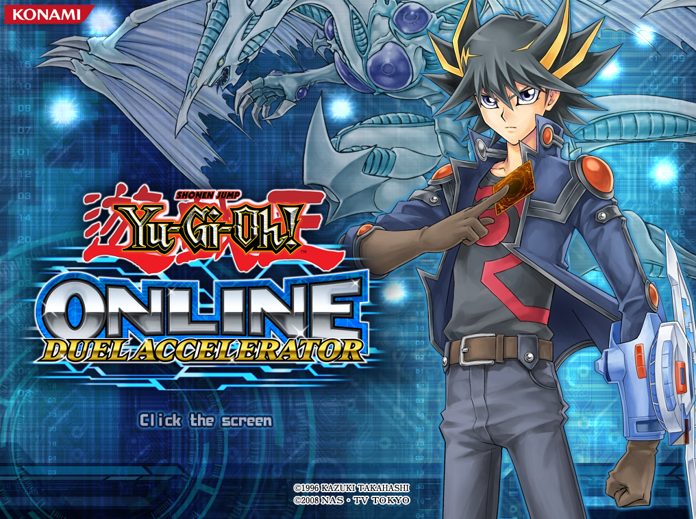

\# Experimental Private Server \& YPK Extraction Tool


An experimental preservation and research project focused on \*\*Yu-Gi-Oh! Online 3: Duel Accelerator (YO3)\*\*.


\[!\[License: MIT](https://img.shields.io/badge/License-MIT-yellow.svg)](LICENSE)

\[!\[Downloads](https://img.shields.io/github/downloads/iteratequickly/ygo3-research/total.svg?label=Downloads)](https://github.com/iteratequickly/ygo3-research/releases)

\[!\[GitHub Release](https://img.shields.io/github/v/release/iteratequickly/ygo3-research)](https://github.com/iteratequickly/ygo3-research/releases)

\[!\[Python](https://img.shields.io/badge/Python-3.12-blue.svg)](https://www.python.org/)

\[!\[Language](https://img.shields.io/github/languages/top/iteratequickly/ygo3-research)](https://github.com/iteratequickly/ygo3-research)


<p align="center">

&#x20; 

</p>


The project contains two main components:


\- An experimental local Python private server exploring the original YO3 client's network communication.

\- A graphical YPK extractor intended for use with archives from across the Yu-Gi-Oh! Online game series.


The aim is to make the original game easier to investigate, preserve and potentially rebuild, while providing tools and research that other developers can build upon.


\## Project Status


\*\*Work in progress – development paused\*\*


This project is experimental and currently incomplete.


The local server can handle some of the initial YO3 client communication, while the YPK extractor can extract supported archive entries.


Full offline functionality has not been achieved, and there is no guarantee that a completely playable offline version will be possible.


\---


\# Experimental Local Private Server


The main focus of this project is an experimental Python server designed to communicate with the original YO3 client locally.


The goal is to understand the initial client/server communication and investigate what would be required to recreate parts of the original online infrastructure.


<p align="center">

&#x20; 

</p>


\## Login


<p align="center">

&#x20; 

</p>


No user ID or password is required for the current test setup.


Leave the login fields blank and press the OK button.


The server currently supplies placeholder account and player information.


\## Select Player


<p align="center">

&#x20; 

</p>


The server currently supplies placeholder player information.


\## Current Progress


The following has been achieved:


1\. The original YO3 client launches.

2\. The client reaches the main menu.

3\. The client proceeds to the login screen.

4\. The client connects to the local Python server.

5\. The server supplies test account profile and player-list responses.


The current stopping point is when the client produces a black screen after selecting a player.


<p align="center">

&#x20; 

</p>


No playable duel functionality has been achieved.


\## How the Server Works


The original game client communicates with the server using its own network protocol.


The experimental server implements a small selection of the observed communication, including:


\- Initial connection handling.

\- Basic authentication and profile responses.

\- Login-related responses.

\- Player-list responses.

\- Player-selection request handling.


The implementation is based on observed client/server communication and experimentation. Not every packet field or protocol behaviour has been fully confirmed.


\## Supported Request Types


The current implementation includes handling for the following observed request types:


| Request  | Response | Description              |

| -------- | -------- | ------------------------ |

| `0x1F47` | `0x219A` | Authentication / profile |

| `0x1F48` | `0x2201` | Login / profile          |

| `0x1F49` | `0x2260` | Player list              |

| `0x1F4C` | `0x2266` | Player selection         |


Additional responses include:


\- Gate response: `0x21FE`

\- Front version-valid response: `0x219F`


These are only the currently implemented or observed parts of the protocol.


\## Network and Packet Handling


The server experiments with the following aspects of the original communication:


\- Blowfish ECB packet encryption.

\- An 8-byte key: `12345678`.

\- Length masking using `0x77777777`.

\- Four-byte word swapping.

\- Eight-byte block alignment.

\- Custom nested map and list encoding.


These details are based on the current implementation and observations. Full protocol compatibility has not been established.


\## Test Account Information


The server currently uses placeholder values, including:


| Field        | Test value |

| ------------ | ---------- |

| User ID      | `1001`     |

| Username     | `test`     |

| Regulation   | `1`        |

| Duel points  | `0`        |

| Player index | `0`        |

| Duel level   | `1`        |


These values are for testing only.


\---


\# Requirements


\- Windows

\- Python 3.12

\- PyCryptodome (for the private server)


Install the required Python package using:


```powershell

py -3.12 -m pip install pycryptodome

```


The YPK extractor uses Python's standard libraries and does not require PyCryptodome.


\---


\# Configuration


The original game configuration file is `yo3.ini`.


The original server settings point to Konami's online services.


For local testing, the relevant settings need to be changed.


\### Original Configuration


```ini

\[Yo3]

GateServerAddress=yo3gate01.yugioh-online.net

GateServerPort=5730

PatchUpdateUrl=http://www.yugioh-online.net/yo3/

PatchDataUrl=http://dl.ygoda.konamionline.com/ygoda/patch/

InfoURL=http://www.yugioh-online.net/app/

```


\### Local Configuration


```ini

\[Yo3]

GateServerAddress=127.0.0.1

GateServerPort=5730

PatchUpdateUrl=http://127.0.0.1/yo3/

PatchDataUrl=http://127.0.0.1/ygoda/patch/

InfoURL=http://127.0.0.1/app/

```


Make a backup of the original `yo3.ini` before changing it.


\*\*Important:\*\* The experimental HTTP server currently implements `/yo3/` only. The `/ygoda/patch/` and `/app/` services are not fully implemented.


\---


\# Local Network Configuration


The server is intended to run locally on the same computer as the game client.


| Service      | Address     | Port   |

| ------------ | ----------- | ------ |

| Local host   | `127.0.0.1` | —      |

| Gate server  | `127.0.0.1` | `5730` |

| Front server | `127.0.0.1` | `1213` |

| HTTP server  | `127.0.0.1` | `80`   |


Port 80 may require elevated permissions or may already be in use by another application.


This setup is intended for local experimentation, not public internet access.


\---


\# HTTP File Service


The experimental HTTP server provides basic file access through the `/yo3/` path.


For example:


```text

http://127.0.0.1/yo3/yo3.idx

```


The server attempts to locate the requested file in the detected game directory.


\- Returns HTTP 200 when the requested file exists.

\- Returns HTTP 404 when the requested file cannot be found.


This is not a complete replacement for the original patch or information services.


\---


\# Running the Private Server


From the project directory, run:


```powershell

py -3.12 server\_launcher.py

```


The server will start its local services and display connection and debugging information.


\## Logging


The server writes its test log to:


`gate\_test.log`


The log records information such as:


\- Incoming connections.

\- Received packets.

\- Decrypted packet contents.

\- Parsed packet fields.

\- Server responses.

\- HTTP requests.

\- Errors and exceptions.


The log is intended for local debugging and is not required for the public project documentation.


\---


\# Private Server Limitations


The private server is still at an early experimental stage.


The following functionality is not currently implemented or confirmed:


\- Full account authentication.

\- Complete profile management.

\- Complete player and lobby management.

\- Duel rooms and matchmaking.

\- Duel sessions.

\- Card and deck synchronisation.

\- Actual duel gameplay.

\- Complete patch and information services.

\- Full compatibility with the original online infrastructure.


The profile and player-list responses currently use placeholder information. Some additional fields have been inferred through experimentation and have not been fully confirmed.


The client crash when hovering over or selecting a player remains unresolved.


\---


\# YPK Archive Extractor


<p align="center">

&#x20; 

</p>


The second major component of this project is the graphical YPK archive extractor.


The extractor is designed as a reusable tool for working with YPK archives across the Yu-Gi-Oh! Online game series, rather than being limited to Duel Accelerator.


Its purpose is to make archived game resources accessible as individual files for inspection, preservation, development and potential rebuilding projects.


\## Features


\- Select one or multiple `.ypk` archives.

\- Choose an output directory through the GUI.

\- Extract recognised archive entries.

\- Preserve internal folder structures.

\- Support stored entries (method 0).

\- Support raw DEFLATE compressed entries (method 8).

\- Automatically decompress supported entries.

\- Validate extracted file sizes and CRC32 checksums.

\- Create separate output folders for each archive.

\- Display extraction progress and a log of results.

\- Leave original archives untouched.

\- No hardcoded archive or output locations.


\## YPK Format Information


The current extractor is based on the archive structure observed during YO3 research.


It recognises the archive entry signature:


`YO\\x03\\x04`


The parser reads information including:


\- Compression method.

\- CRC32 checksum.

\- Compressed and uncompressed sizes.

\- Filename length.

\- Extra field length.

\- Filename and compressed payload.


\## Supported Compression Methods


| Method | Description               | Support                 |

| ------ | ------------------------- | ----------------------- |

| 0      | Stored / no compression   | Supported               |

| 8      | Raw DEFLATE               | Supported               |

| Other  | Other compression methods | Not currently supported |


\## Cross-Game Compatibility


The extractor is intended to be reusable across the Yu-Gi-Oh! Online game series. It is not tied to a particular game installation or hardcoded archive location.


The GUI allows users to select archives from different installations and choose where their contents should be extracted.


Compatibility depends on the archive structure and compression methods used by each title. The current implementation supports the YPK structure and methods understood by the project. Other archive variants may require additional format handling.


Not every Yu-Gi-Oh! Online title or archive variant has been independently tested, so universal compatibility is not yet guaranteed.


\## How to Use


1\. Run `ypk\_extractor.py`.

2\. Select the YPK archives you want to extract.

3\. Choose an output folder.

4\. Start the extraction.

5\. Monitor progress and results in the log window.


Each archive is extracted into its own folder, helping keep extracted resources organised.


\## Running the Extractor


```powershell

py ypk\_extractor.py

```


The extractor uses Python's standard libraries and Tkinter for its graphical interface. No third-party Python packages are required, provided Tkinter is available.


\## Extraction and Resource Rebuilding


The ability to extract the contents of YPK archives is useful for much more than simply inspecting individual files.


By making archived game resources accessible, the extractor provides developers with material they can investigate, organise and potentially use as a foundation for rebuilding parts of the original games.


Combined with the network research and tools in this project, this could help make possible community-developed projects such as:


\- Custom clients and alternative client implementations.

\- Rebuilt game interfaces and resource systems.

\- Independent tools for viewing, editing and managing game assets.

\- Preservation projects covering multiple Yu-Gi-Oh! Online titles.

\- Alternative local server implementations.

\- Experiments aimed at recreating parts of the original games.


The intention is to give other developers access to useful resources and a starting point for their own projects, rather than making development dependent on this particular private-server implementation.


\*\*Note:\*\* Extracting resources does not automatically provide all the code, functionality or infrastructure required for a complete playable recreation.


\---


\# Possible Community Development


This project is intended to provide useful starting points for other developers interested in Yu-Gi-Oh! Online preservation and experimentation.


The archive extractor makes game resources accessible, while the server implementation and protocol research provide examples of how the original YO3 client communicates.


Together, these may allow other developers to explore ideas independently, including custom clients, alternative server implementations and attempts to rebuild parts of the original games.


These are possibilities rather than promised project features. No completed custom client or full recreation is currently provided.


\---


\# Original Game Files


The project is intended to work with original game clients and their existing game archives.


The extractor reads the original YPK archives and writes extracted files separately. It does not modify the original archives.


Keep backups of original game files and configuration before experimenting.


\---


\# Disclaimer


This is an independent fan-made research and preservation project.


It is not affiliated with, endorsed by or supported by Konami.


All software is provided as-is, without guarantees of functionality, compatibility or continued development.


Yu-Gi-Oh! and related trademarks and assets belong to their respective owners.


\---


\# Summary


The project explores two areas of Yu-Gi-Oh! Online preservation:


1\. \*\*Private server research:\*\* Experimenting with local YO3 server emulation and documenting observed communication with the original client.

2\. \*\*Game resource access:\*\* Extracting YPK archives so their contents can be investigated and potentially reused in independent rebuilding efforts across the game series.


The aim is to make useful tools, resources and research available to the community, giving other developers the opportunity to explore their own ideas and potentially take the project in directions beyond its original scope.


\---


\## 📄 License


This project is licensed under the \[MIT License](LICENSE).

