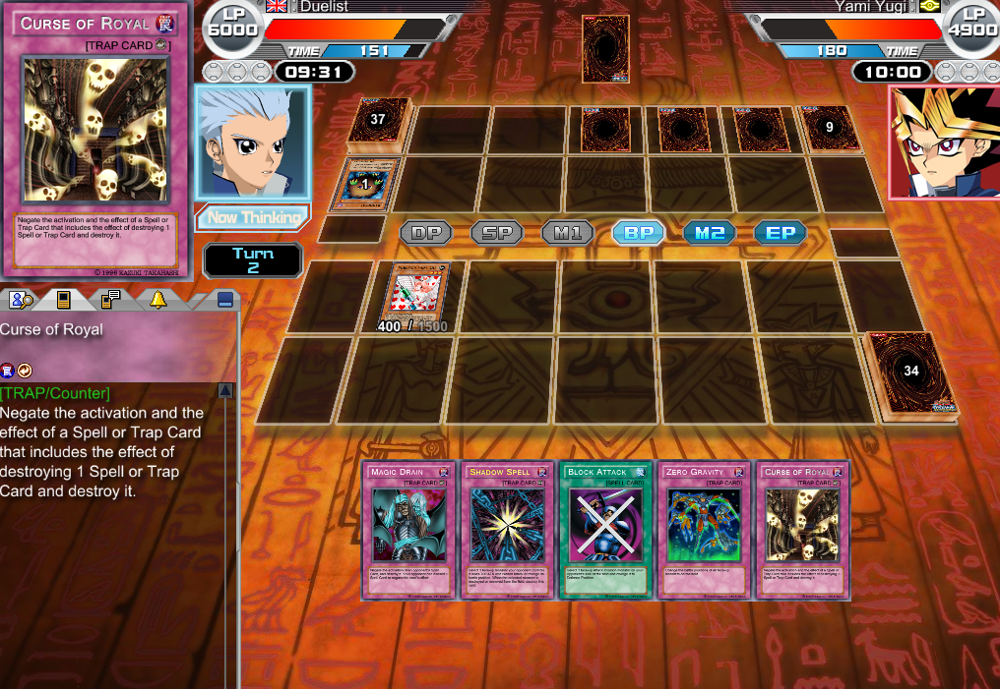
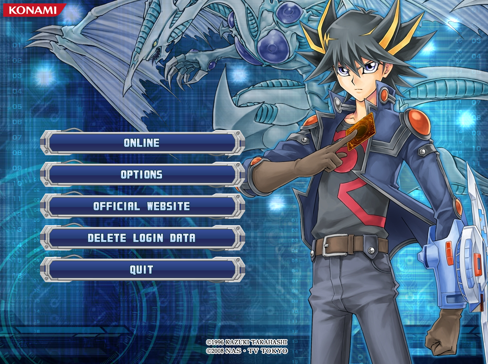
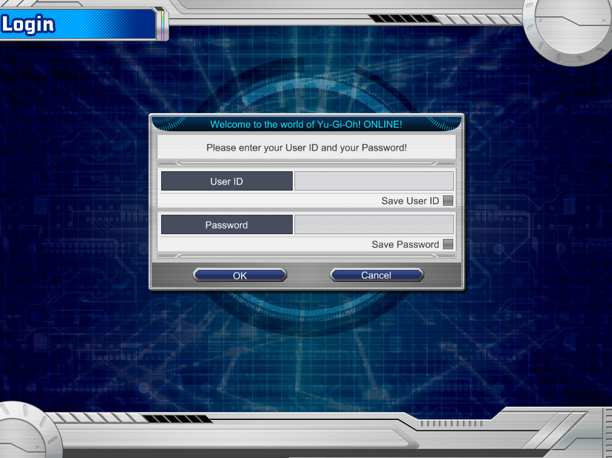
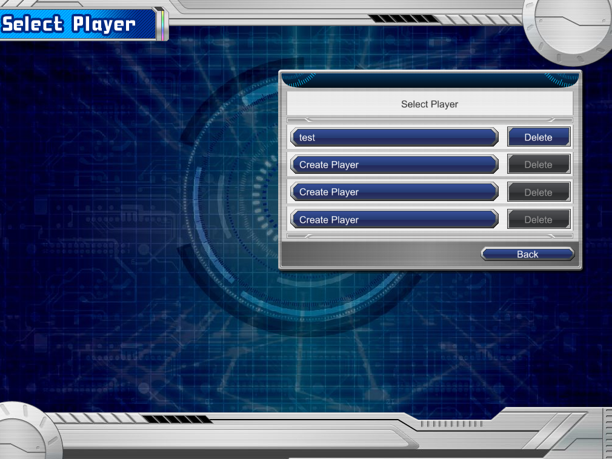
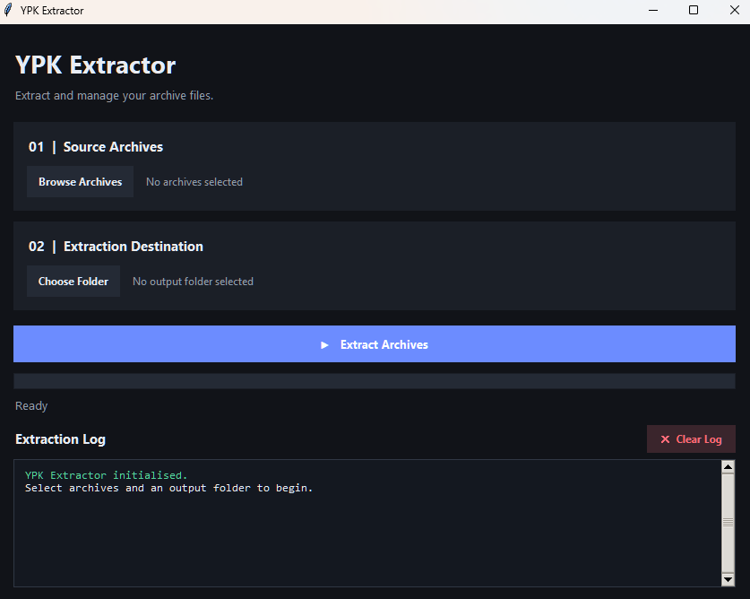

# Experimental Private Server & YPK Extraction Tool

[](LICENSE)
[](https://github.com/iteratequickly/ygo3-research/releases)
[](https://github.com/iteratequickly/ygo3-research/releases)
[](https://www.python.org/)
[](https://www.python.org/)

An experimental preservation and research project focused on **Yu-Gi-Oh! ONLINE 3: Duel Accelerator**.

This project combines an experimental local private server with a graphical YPK archive extraction tool. The goal is to investigate the original game's network communication, understand its data formats, access its resources, and support further preservation and community development.

## Screenshots



### Private Server Progress

| Main Menu | Login Screen |
|---|---|
|  |  |

| Player Selection | Client State |
|---|---|
|  |  |

### YPK Extractor



---

## Project Status

**Work in progress.**

This project is experimental and incomplete.

The private server has progressed beyond initial connection handling and contains server-side components for account, player, card, shop, and duel functionality. However, full end-to-end compatibility with the original client has not been established.

The original initial milestone was getting the client to connect to a local Python server, pass the initial login flow, and receive test account and player-list information. At that stage, the client reached a black screen after player selection.

Further server-side duel and game-system development has been added since that milestone, but a complete playable offline experience has not been verified.

The YPK extractor supports extraction of recognized archive entries, subject to the archive format and compression methods implemented.

There is no guarantee that a fully playable offline version of the original game can be achieved.

---

# Part 1 – Experimental Local Private Server

## Overview

The private server is an experimental Python implementation intended to reproduce selected parts of the original Yu-Gi-Oh! ONLINE 3 server infrastructure.

It investigates how the original client communicates with its servers and provides local responses for supported requests.

The server is designed to run locally and provides separate listeners for the different game communication services.

### Current Server Progress

The initial connection and login research established that:

1. The original client can be launched.
2. The client reaches the main menu.
3. The client reaches the login screen.
4. The client can connect to the local Python server.
5. The server can respond to initial authentication and profile requests.
6. The server can supply test account information.
7. The server can provide player-list responses.
8. The client can proceed to player selection.

Additional server-side functionality has since been developed, including duel-engine integration and game-system components. However, the original client still requires further testing and compatibility work.

## How the Server Works

The server uses observations of the original client's network communication to implement selected protocol operations.

The current implementation includes research into:

- Initial Gate server communication.
- Front server communication.
- Authentication and profile responses.
- Login handling.
- Player-list handling.
- Player selection.
- Duel server communication.
- HTTP resource requests.
- Card and deck data.
- Game state management.
- Duel-engine integration.

Not every packet field or protocol behaviour has been fully confirmed. Some responses and values remain experimental or inferred.

## Supported Request Types

The following request types were identified during the initial protocol research:

| Request | Response | Purpose |
|---|---|---|
| `0x1F47` | `0x219A` | Authentication/profile |
| `0x1F48` | `0x2201` | Login/profile |
| `0x1F49` | `0x2260` | Player list |
| `0x1F4C` | `0x2266` | Player selection |

Additional observed response types include:

| Response | Purpose |
|---|---|
| `0x21FE` | Gate response |
| `0x219F` | Front version validation |

These packet identifiers describe the currently researched protocol paths. They should not be interpreted as proof of complete protocol compatibility.

## Network and Packet Handling

The original client uses an encrypted packet format.

The experimental implementation includes:

- Blowfish encryption.
- ECB block mode.
- An 8-byte encryption key: `12345678`.
- Length masking using `0x77777777`.
- Four-byte word swapping.
- Eight-byte block alignment.
- Custom nested map/list data encoding.

These details are based on protocol observations and implementation research.

The packet implementation is experimental and may not cover every packet type or edge case used by the original infrastructure.

## Test Account Information

The current test setup uses placeholder account and player information.

| Field | Test Value |
|---|---|
| User ID | `1001` |
| Username | `test` |
| Regulation | `1` |
| Duel Points | `0` |
| Player Index | `0` |
| Duel Level | `1` |

These values are for local testing and are not connected to original online accounts.

### Login Instructions

For the current test setup:

1. Start the local server.
2. Launch the original game client.
3. Open the login screen.
4. Leave the user ID and password fields blank.
5. Press OK.
6. Allow the local server to supply the placeholder account information.

The player selection screen uses placeholder player information.

---

## Server Features

The server implementation contains components for:

- Gate server communication.
- Front server communication.
- Duel server communication.
- HTTP resource serving.
- Test account and profile handling.
- Player-list responses.
- Player selection.
- Card database access.
- Deck-related data.
- BP management.
- Card management.
- Persistent server state.
- Duel management.
- EDOPro OCG core integration.

The availability and completeness of individual features depend on the current server implementation and original client compatibility.

## Duel System

The project includes experimental duel functionality using the EDOPro OCG engine.

The server loads the OCG core through Python's native-library interface and uses it to provide card-game rules and duel processing.

### EDOPro Integration

The duel engine is from **Project Ignis / EDOPro**.

Project Ignis download page:

https://projectignis.github.io/download.html

Required EDOPro components include:

- `ocgcore.dll`
- `cards.cdb`
- Lua scripts, including `constant.lua` and `utility.lua`

The server uses the OCG core to handle duel-related operations.

The exact functionality available depends on the compatibility of the selected OCG core, card database, scripts, and server implementation.

### Architecture Compatibility

Python and `ocgcore.dll` must use matching architectures.

- 32-bit Python requires a 32-bit `ocgcore.dll`.
- 64-bit Python requires a 64-bit `ocgcore.dll`.

A 64-bit Python installation is supported when the corresponding 64-bit OCG core is available.

The GUI's 32-bit interpreter detection and check options are provided as conveniences for the standard 32-bit setup. They do not mean that the entire project is restricted to 32-bit Python.

### Card Database

The server uses `cards.cdb` to retrieve card information.

Card-related functionality depends on the database being available and compatible with the OCG core.

### Lua Scripts

The EDOPro Lua script directory must contain the scripts required by the OCG engine.

Important files include:

- `constant.lua`
- `utility.lua`

Missing or incompatible scripts may prevent correct duel initialisation or card effects.

### Duel Data Conversion

The duel manager includes conversion between YO3 card data and the OCG engine's expected card identifiers.

This includes converting YO3 big-endian 16-bit card rows into OCG card passcodes.

### Duel Timers

The server includes separate timing values for:

- Individual turns.
- Total game duration.

Current configured values:

| Timer | Duration |
|---|---:|
| Turn timer | 180 seconds |
| Total game timer | 600 seconds |

These are server-side timer settings. Their complete presentation and behaviour in the original game client remain subject to compatibility testing.

### NPC Behaviour

The experimental NPC logic includes attack handling.

The current attack logic attempts to:

1. Perform a legal direct attack when permitted.
2. Otherwise, select an opposing monster that can legally be attacked.
3. End the Battle Phase when no legal attack is available.

This is experimental AI behaviour and does not represent a complete recreation of the original game's AI.

---

## Game Data and Configuration

The server uses configurable paths for the game installation, OCG core, card database, Lua scripts, persistent data, and web resources.

Default server data path:

`data/yo3_state.pkl`

Default web directory:

`www`

The server also supports environment-variable configuration.

### Environment Variables

| Variable | Purpose |
|---|---|
| `YGO3_GAME_DIR` | Original game directory |
| `YGO3_DLL_PATH` | OCG core DLL path |
| `YGO3_CARD_DB` | Card database path |
| `YGO3_SCRIPT_DIR` | Lua script directory |
| `YGO3_DATA_DIR` | Persistent data directory |
| `YGO3_WEB_DIR` | HTTP web root |
| `YGO3_HOST` | Server bind address |
| `YGO3_FRONT_ADDRESS` | Front server address |
| `YGO3_GATE_PORT` | Gate server port |
| `YGO3_FRONT_PORT` | Front server port |
| `YGO3_DUEL_PORT` | Duel server port |
| `YGO3_HTTP_PORT` | HTTP server port |

---

## Original Game Configuration

The original game uses a `yo3.ini` configuration file.

### Original Configuration

The original configuration may contain entries similar to:

```ini
[Yo3]
GateServerAddress=yo3gate01.yugioh-online.net
GateServerPort=5730
PatchUpdateUrl=http://www.yugioh-online.net/yo3/
PatchDataUrl=http://dl.ygoda.konamionline.com/ygoda/patch/
InfoURL=http://www.yugioh-online.net/app/
```

### Local Server Configuration

For local experimentation, the configuration can be changed to:

```ini
[Yo3]
GateServerAddress=127.0.0.1
GateServerPort=5730
PatchUpdateUrl=http://127.0.0.1/yo3/
PatchDataUrl=http://127.0.0.1/ygoda/patch/
InfoURL=http://127.0.0.1/app/
```

**Important:** Back up the original `yo3.ini` before making changes.

The experimental HTTP server has support for the relevant route structure, but the `/ygoda/patch/` and `/app/` services are not yet complete replacements for the original services. The `/yo3/` resource path is the primary implemented resource service.

---

## Local Network Configuration

The default local configuration uses:

| Service | Address | Port |
|---|---|---:|
| Gate server | `127.0.0.1` | `5730` |
| Front server | `127.0.0.1` | `1213` |
| Duel server | Configurable | Configurable |
| HTTP server | `127.0.0.1` | `80` |

The server ports can be changed through the GUI or environment variables.

**Note:** Port 80 may require administrator privileges on Windows or may already be in use by another application.

This configuration is intended for local experimentation. It is not a recommendation to expose the experimental server directly to the public internet.

## HTTP File Service

The server includes an experimental HTTP service for game resources.

The primary resource route is:

`/yo3/`

For example:

`http://127.0.0.1/yo3/yo3.idx`

The service attempts to locate requested files inside the detected game directory.

Expected behaviour:

- HTTP `200` when the requested file exists.
- HTTP `404` when the requested file cannot be found.
- HTTP `403` for blocked or unsafe paths.
- HTTP `405` for unsupported request methods.

The service supports GET and HEAD requests and includes path traversal protection.

The `/ygoda/patch/` and `/app/` routes are not yet complete replacements for the original patch and information services.

---

# Server Control GUI

The graphical launcher is:

`ygo3_gui.py`

Start it with:

```bash
py ygo3_gui.py
```

The GUI is built with CustomTkinter and provides a central interface for configuring and controlling the server.

## GUI Tabs

The launcher contains three main tabs:

1. Server Settings
2. BP Manager
3. Server Logs

### Server Settings

The Server Settings tab allows configuration of:

- Server Python script.
- Original game directory.
- OCG core DLL.
- `cards.cdb` database.
- Lua script directory.
- Persistent data directory.
- HTTP web directory.
- Python interpreter.
- Server bind address.
- Front server address.
- Gate server port.
- Front server port.
- Duel server port.
- HTTP server port.

The GUI stores its settings in:

`ygo3_launcher_config.json`

The configuration is intended to make it easier to switch between different game installations and server environments.

### Python Interpreter Selection

The GUI allows the user to select the Python interpreter used to launch the server.

It also includes:

- A Find 32-bit option.
- A Python environment check.

The check verifies the 32-bit Python setup and tests whether `Crypto.Cipher.Blowfish` can be imported.

This is a convenience for the standard 32-bit configuration. A matching 64-bit Python and 64-bit OCG core can also be used.

### Server Controls

The GUI provides:

- Start Server.
- Stop Server.
- Server status display.

The server process is launched using the selected Python interpreter and server script.

---

## BP Manager

The BP Manager tab provides an interface for changing a test account's BP balance.

It accepts:

- User ID.
- BP amount.

The GUI invokes the server script using the `--grant-bp` command-line option.

Example:

```bash
py ygo3_server.py --grant-bp AMOUNT USER_ID
```

The manager includes validation for:

- Positive BP amounts.
- Non-negative user IDs.
- Maximum 32-bit unsigned BP values.
- Available remaining BP capacity.

The manager also accounts for the server's persistent state.

**Important:** Stop the running server before making BP changes. The GUI attempts to restart the server after the operation to avoid an old in-memory state overwriting the updated data.

---

## Server Logs

The Server Logs tab captures server process output.

It includes:

- Standard output.
- Standard error.
- Live log output.
- Clear log display.
- Process status.
- Process exit code.

The logs are useful for debugging connection issues, packet handling, HTTP requests, OCG initialisation, and server errors.

---

## Running the Server

The main server file is:

`ygo3_server.py`

### Start the Server Directly

```bash
py ygo3_server.py
```

### Start the GUI

```bash
py ygo3_gui.py
```

The GUI is the recommended way to configure and manage the server.

### Available Command-Line Options

The server includes additional command-line operations.

#### Check Game Installation

```bash
py ygo3_server.py --check-game
```

#### Search the Card Database

```bash
py ygo3_server.py --card-search
```

#### Grant BP

```bash
py ygo3_server.py --grant-bp AMOUNT USER_ID
```

#### Grant a Card

```bash
py ygo3_server.py --grant-card
```

The card-grant operation uses the server's command-line interface and its configured data paths.

---

## Server Logging

The server records information useful for protocol research and debugging.

Depending on the operation, logs may include:

- Incoming connections.
- Received packets.
- Decrypted packet contents.
- Parsed packet fields.
- Server responses.
- HTTP requests.
- OCG engine initialisation.
- Errors and exceptions.

The original research setup also used:

`gate_test.log`

Logs are intended for local debugging and development.

---

## Requirements

### Operating System

- Windows is the primary target environment.
- Other operating systems may require additional configuration.

### Python

Python 3.12 is the documented development version.

The Python architecture must match the architecture of `ocgcore.dll`.

| Python | OCG core |
|---|---|
| 32-bit | 32-bit DLL |
| 64-bit | 64-bit DLL |

### Python Dependencies

The private server and GUI use:

- `pycryptodome`
- `customtkinter`

Install the dependencies with:

```bash
py -3.12 -m pip install pycryptodome customtkinter
```

If using a different Python interpreter, install the dependencies into that interpreter instead.

The Blowfish implementation requires:

```python
from Crypto.Cipher import Blowfish
```

### EDOPro Requirements

The duel system requires compatible EDOPro components:

- `ocgcore.dll`
- `cards.cdb`
- Lua scripts.
- `constant.lua`
- `utility.lua`

The architecture of the OCG core must match the Python interpreter.

### YPK Extractor Requirements

The YPK extractor uses Python's standard library and Tkinter.

It does not require PyCryptodome or CustomTkinter.

---

# Part 2 – YPK Archive Extractor

## Overview

The YPK extractor is a graphical tool for extracting supported YPK archives from the Yu-Gi-Oh! ONLINE game series.

It is not limited to Yu-Gi-Oh! ONLINE 3.

The tool is intended to help with preservation, resource inspection, and research across different releases in the series.

## Features

- Select one or multiple `.ypk` archives.
- Choose an output directory.
- Extract recognized archive entries.
- Preserve internal folder structures.
- Support stored entries.
- Support raw DEFLATE compressed entries.
- Automatically decompress supported entries.
- Validate extracted file sizes.
- Validate CRC32 checksums.
- Create separate output folders for each archive.
- Display extraction progress.
- Provide extraction logs.
- Leave original archives untouched.
- Avoid hardcoded game installation paths.

## YPK Archive Format

The extractor recognises the following signature:

```text
YO\x03\x04
```

The parser reads archive metadata, including:

- Compression method.
- CRC32 checksum.
- Compressed size.
- Uncompressed size.
- Filename length.
- Extra field length.
- Filename.
- Compressed payload.

### Supported Compression Methods

| Method | Description | Support |
|---|---|---|
| `0` | Stored / uncompressed | Supported |
| `8` | Raw DEFLATE | Supported |
| Other | Other compression methods | Not currently supported |

The extractor checks the extracted data against the recorded file size and CRC32 value where applicable.

## How to Use the YPK Extractor

Run:

```bash
py ypk_extractor.py
```

Then:

1. Select one or more YPK archive files.
2. Choose an output directory.
3. Start extraction.
4. Monitor the progress and log output.
5. Open the generated output folders.

Each archive is extracted into its own separate output folder.

The original YPK files are not modified.

## Compatibility

The extractor is designed to be reusable across the Yu-Gi-Oh! ONLINE game series.

Actual compatibility depends on the archive structure and compression methods used by each game release.

Universal compatibility with every YPK variation has not been established.

---

# Part 3 – Preservation and Community Development

## Resource Rebuilding

Extracted resources may be useful for future research and preservation projects, including:

- Custom clients.
- Rebuilt user interfaces.
- Alternative resource systems.
- Tools for viewing game assets.
- Tools for editing and managing extracted resources.
- Multi-game preservation projects.
- Alternative server implementations.
- Experiments recreating original game systems.

Extracting resources alone does not create a complete playable recreation of the original game.

## Community Development

The project is intended to support further experimentation and community research.

Potential areas for future development include:

- Completing the original client connection flow.
- Improving protocol compatibility.
- Expanding account and player management.
- Improving duel integration.
- Implementing missing game services.
- Improving card and deck handling.
- Expanding YPK format compatibility.
- Developing resource inspection tools.
- Investigating alternative client implementations.

These are potential development areas, not claims that the features are already complete.

---

# Known Bugs and Outstanding Issues

The following issues have been identified during testing and development.

| Issue | Description |
|---|---|
| Eagle selection crash | Selecting Eagle causes the client to crash. |
| Structure Decks | Structure Decks are not visible in the shop. |
| Duel Disks | Duel Disks are not visible in the shop. |
| Special Packs | Special Packs are not visible in the shop. |
| Roshambo timer | The time is not displayed during the Rock, Paper, Scissors selection step. |
| Spell cards | Activated Spell cards do not move to the Graveyard as expected. |
| Trap cards | Activated Trap cards do not move to the Graveyard as expected. |

These issues remain outstanding and require further investigation.

---

# Private Server Limitations

The private server is experimental and does not currently guarantee complete compatibility with the original game.

Areas that remain incomplete or require further verification include:

- Full account authentication.
- Complete profile management.
- Complete player and lobby management.
- Complete duel room and matchmaking functionality.
- Complete duel session handling.
- Card and deck synchronisation.
- Complete original-client duel gameplay.
- Complete shop functionality.
- Complete game item handling.
- Complete patch services.
- Complete information services.
- Full compatibility with the original online infrastructure.

Some profile and player-list values are placeholders.

Some protocol fields and behaviours have been inferred rather than confirmed.

Client crashes and unexpected behaviour may occur when using features that have not been fully implemented.

---

# Troubleshooting

## The Server Does Not Start

Check that:

- Python is installed.
- The correct Python interpreter is selected.
- The required dependencies are installed.
- The selected server script exists.
- The configured ports are available.

## Blowfish Import Error

Install PyCryptodome into the Python environment used by the server:

```bash
py -3.12 -m pip install pycryptodome
```

Test the import:

```bash
py -3.12 -c "from Crypto.Cipher import Blowfish; print('Blowfish OK')"
```

## OCG Core Fails to Load

Check that:

- `ocgcore.dll` exists.
- The DLL architecture matches Python.
- The DLL is compatible with the selected EDOPro files.
- The configured path is correct.

Remember:

- 32-bit Python requires a 32-bit OCG core.
- 64-bit Python requires a 64-bit OCG core.

## Card Database Problems

Check that:

- `cards.cdb` exists.
- The GUI points to the correct database.
- The database is compatible with the selected OCG core.

## Lua Script Problems

Check that the configured script directory contains the required Lua files, particularly:

```text
constant.lua
utility.lua
```

## HTTP Resource Errors

Check that:

- The game directory is correct.
- The requested resource exists.
- The web root is configured correctly.
- The HTTP port is available.
- The requested route is implemented.

The `/ygoda/patch/` and `/app/` services are not yet complete replacements for the original services.

## The Original Client Gets Stuck

The private server is experimental.

A black screen or stalled client may indicate:

- An unsupported packet.
- An incomplete server response.
- Missing game resources.
- An incorrect client configuration.
- An unimplemented game service.
- An unexpected client-side dependency.

Check the server logs for connection activity, packet handling, and errors.

---

# Original Game Files

This project is intended for preservation and research.

The YPK extractor reads archive files and writes extracted resources to a separate output directory.

It does not intentionally modify the original archives.

Always back up original game files and configuration files before experimenting.

---

# Disclaimer

This is an independent fan-made research and preservation project.

It is not affiliated with, endorsed by, or supported by Konami.

Yu-Gi-Oh! and related names, trademarks, characters, artwork, and game assets belong to their respective rights holders.

This project is provided **as-is**, without warranties or guarantees of any kind.

The user is responsible for ensuring that their use of the software and any extracted resources complies with applicable laws and the rights of the relevant intellectual property owners.

---

# Summary

This project contains two main components:

### 1. Experimental Private Server

A Python-based experimental server for researching and recreating selected parts of the original Yu-Gi-Oh! ONLINE 3 server infrastructure.

It includes network protocol research, local server services, account and player handling, experimental duel functionality, and EDOPro integration.

Main files:

- `ygo3_server.py`
- `ygo3_gui.py`

### 2. YPK Archive Extractor

A graphical archive extraction tool designed to access supported YPK resources from Yu-Gi-Oh! ONLINE games.

Main file:

- `ypk_extractor.py`

Together, these tools provide a foundation for further experimentation, preservation, resource research, and possible community development.

---

# License

This project is licensed under the MIT License.

See [LICENSE](LICENSE) for details.
